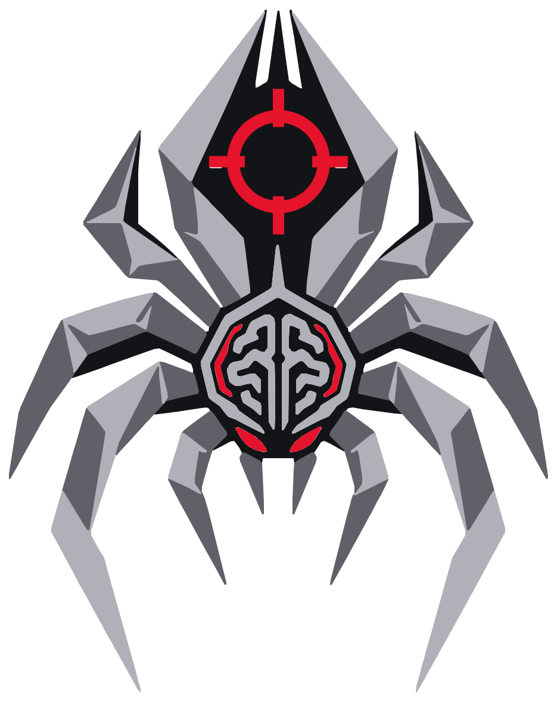
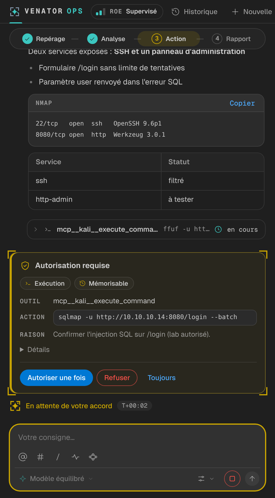
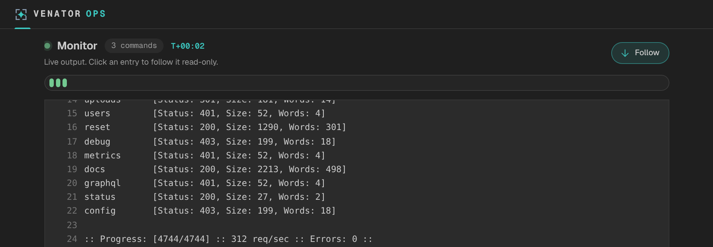
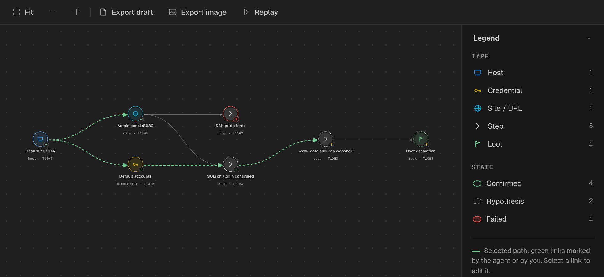
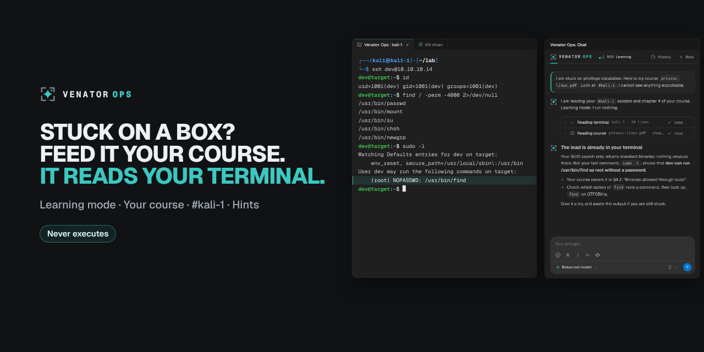

# RedWidow

**Pentest in VS Code, with AI on call.**

Your Docker Kali and Exegol containers, their terminals, a Monitor, a kill chain
and reports in one place. An AI agent backs you up whenever you call it.

---

> **Use only in an authorized setting**: CTFs, certification labs, or an
> engagement with a defined scope and written permission.

> English version. The French README is the reference: [README.md](README.md). Screenshots below show the previous Venator Ops identity.

## Why RedWidow

A pentest means dozens of terminals, scans and notes scattered everywhere.
RedWidow brings them together inside VS Code:

- **Your Docker Kali and Exegol containers** are prepared and managed from the cockpit.
- **Your terminals** open straight inside the container, like any other editor terminal.
- **The Monitor** follows every command the agent runs: its status and its live output.
- **The kill chain** maps what you find: hosts, credentials, sites, steps and loot, linked together, with the MITRE ATT&CK technique of each step.
- **An AI agent** runs the tools in your container, explains results and suggests next leads.

## What you can do

### Work with the agent

Write your prompt in the chat and the agent takes it from there. When an action
needs your approval, a card shows the tool, the command and the reason.

In the chat you also get:

- `@` to mention a container, `#` to mention an open terminal (the agent reads its output), `/` for commands;
- up to **four conversations** in parallel, with **shared history** across chat tabs and the sidebar, filtered by project;
- a choice of **model** and **reasoning effort** for the next message;
- web search (documentation, READMEs, GitHub releases), with sources and the date they were read.

### Follow the execution: the Monitor

Each command shows up with its status and live output. A timeline lets you jump
to any command, and the down arrow turns auto-follow on or off.

### Keep a trace of what you tested

**Audit starts automatically with your active project**, even when you work without AI.
It keeps agent actions, approval decisions and periodic captures of project-linked
terminals opened by Venator. Open **Settings → Audit** to filter the timeline,
review test drafts and record your assessment, including negative or inconclusive results.

A successful command is not a validated test. The agent can annotate a test with
references to real tool results; only your assessment receives the **Reviewed by
operator** label. Audit storage is separate from chat history and is not automatically
purged. You can pause it from the Audit page; interruptions and capture limits are visible.

**Export audit bundle** creates a local ZIP with standalone HTML, the test-registry
preview, retained evidence, full retained JSONL journals and a SHA-256 manifest.
Terminal capture is periodic and bounded, so it can miss output between samples;
external terminals and applications are outside its scope. Large missions have a
bounded preview. Hashes help check file integrity; they are not a signature or an
independent timestamp. [Capture details and limits](docs/audit.md).

### Follow your attack: the kill chain

Hosts, credentials, sites, steps, loot: every finding has a **state**
(confirmed, hypothesis, failed), a **MITRE ATT&CK technique** and cause-and-effect
links to the others. The graph works with mouse and keyboard, and **Replay**
walks the selected path node by node.

### Learn: Learning mode

Stuck on an HTB box? Give it your course, mention your terminal session with
`#`, and it explains where you stand based on what you actually typed. The mode
is read-only: it cites its sources and points you in the right direction.

### Keep a record and write it up

Every mission is logged so you can read it back. The **report preview** shows
the active project's findings without credentials or loot, and the export
produces a **Markdown draft** to complete with your evidence and remediations.
Severities stay “To be assessed”: you decide them yourself. No external
reporting tool is needed.

## Without AI

RedWidow helps you organize a pentest even without an account or an AI
provider.

- **Projects**: a name, a working folder and the containers that go with it, with a summary you write and edit yourself.
- **The cockpit**: create, start, stop and link your Docker Kali and Exegol containers. Kali images are prepared for you.
- **Your terminals in the container**: open a terminal in Kali or Exegol from VS Code and work as usual.
- **The kill chain**: browse the project's findings graph, mark the selected path and replay it.
- **The report draft**: preview and Markdown export.

The day you want some help, add a provider in **Configure**: the chat, the
Monitor and the automatic feeding of the kill chain then rely on the agent.

## Installation

Requirements: **VS Code 1.90 or later** and **Docker** for the containers.

1. Download the `.vsix` file for your platform (**Windows** or **Linux**) from the [releases](https://github.com/tomtimlt/warband/releases).
2. Install it: `code --install-extension <file>.vsix`, or in VS Code **Extensions → … → Install from VSIX**.
3. Reload the VS Code window.

RedWidow is not on the Marketplace yet: installation is manual.

## First launch

1. Open a **trusted folder** in VS Code.
2. Open **Settings → Project**: activate a project or create one (a name and a folder).
3. In the **cockpit**, link the project's Kali or Exegol containers, or create them.
4. To use the agent, open **Configure** in the chat, pick your provider and add your access. It is stored in VS Code's secure storage.
5. Open the chat (the RedWidow icon in the activity bar) and write your prompt.

| Shortcut | Action |
| --- | --- |
| `Alt+J Alt+J` | Launcher |
| `Alt+J C` | Side chat |
| `Alt+J N` | New chat in the editor |
| `Alt+J K` | Cockpit |
| `Alt+J M` | Monitor |
| `Alt+J S` | Settings |

## FAQ

**Which AI providers are supported?**
**Claude** (subscription token or API key), **OpenAI** (ChatGPT subscription or API key), and **OpenCode**, with its full provider catalog, including Gemini, OpenRouter, GitHub Copilot, DeepSeek, Ollama and compatible endpoints. You can switch provider and keep the same conversation.

Open **Settings → System control** to search OpenCode’s runtime provider catalog, configure connections and enable the providers you want in the chat’s **Configure** menu. **OpenCode** also remains available as a general entry showing all connected models. For Ollama or another compatible endpoint, use **Add Ollama / a compatible endpoint** and enter its API URL and installed model IDs.

**Which systems does it run on?**
Windows (native, no WSL) and Linux.

**Where is my data?**
Conversation logs are stored by VS Code on your machine, outside your repository. The history keeps roughly the last 100 conversations, and passwords, tokens and keys are masked before anything is written to a log.

**What is Bypass for?**
Running a long sequence without clicking on every card. It is set in **Configure**, lasts 2 hours and is shown in magenta with a countdown.

**Are there profiles for my context?**
Yes: enable method profiles in **Settings → System control**, then choose one in the chat’s **+** menu: mentor, bug bounty, out of the box, red team or HTB. A short brief guides the next turn; detailed methods load only when needed. The same menu lets you attach configured MCP connectors and opt into web search for this conversation. See the [profile guide](docs/profils-agent.md).

**Does the interface follow my theme?**
Yes: light, dark and high-contrast themes, reduced motion respected, and five color sets to choose from in **Settings → Appearance**. English is the default interface language; switch between **EN / FR** in Settings.

## Status

A personal project under active development. The published version is installed by hand (`.vsix`) and has not yet been tried in every VS Code setup (remote windows, web version). Known limitations are listed in the [extension guide](docs/extension-vscode.md#limites-connues).

## Going further

| | |
| --- | --- |
| [Extension guide](docs/extension-vscode.md) | Installation, usage and limitations |
| [Project status](docs/etat-du-projet.md) | What exists and what is left to do |
| [Command line](docs/cli.md) | Driving the engine and the approval policy outside VS Code |
| [Development](docs/adr/README.md) | For developers: architecture decisions and code layout |

The detailed documentation is currently written in French.

## License

[MIT](LICENSE).
