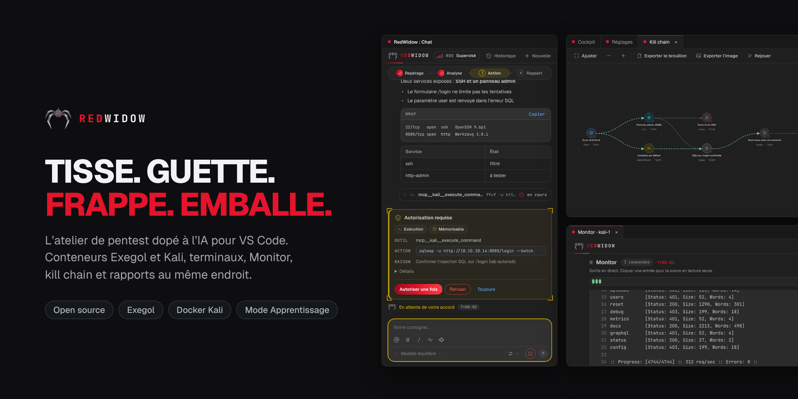
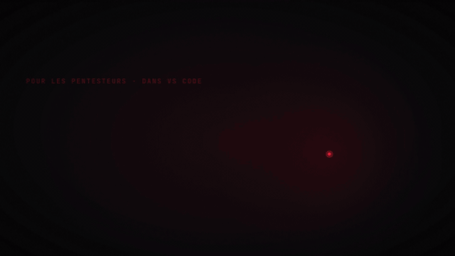
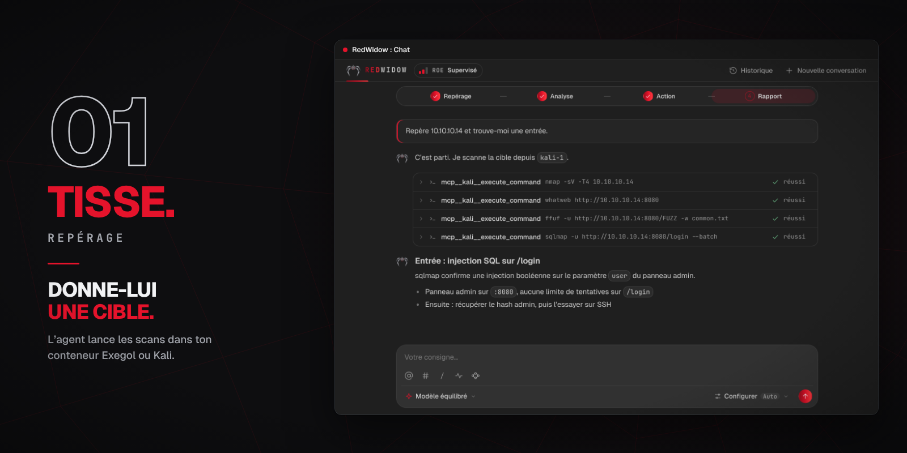
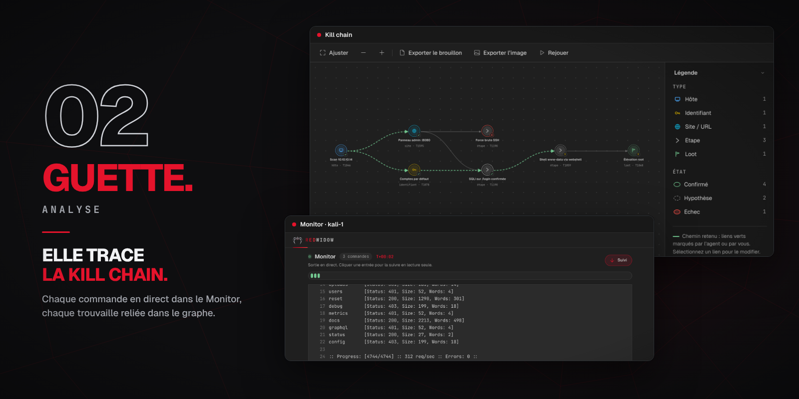
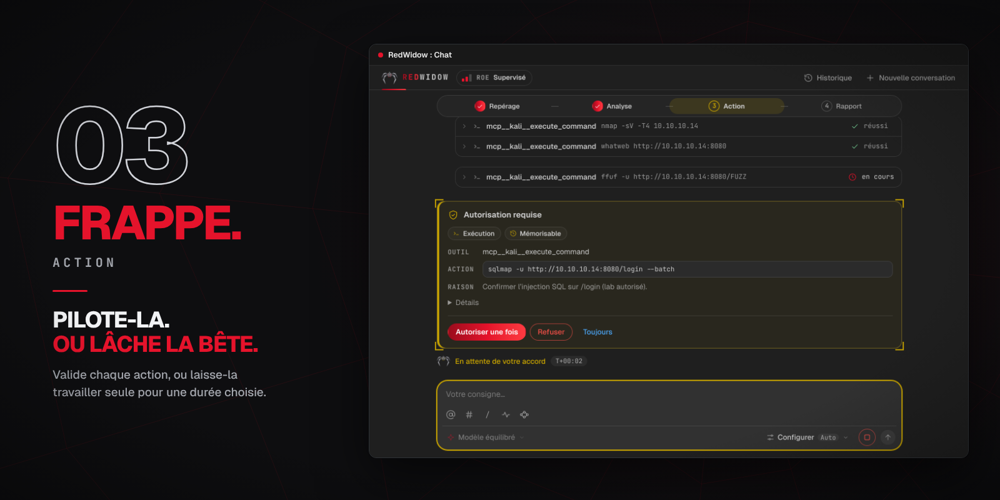
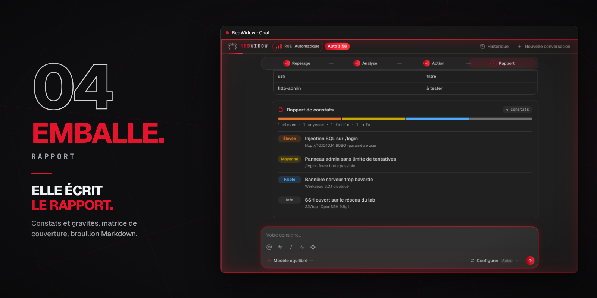
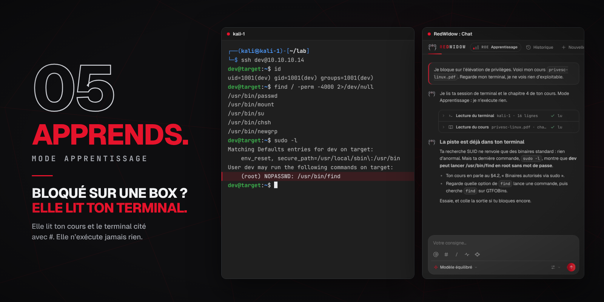
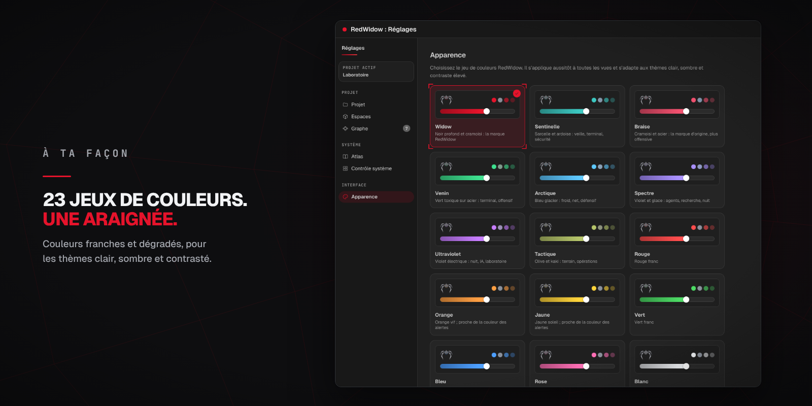

<div align="center">



<br>
<br>

Vos conteneurs Exegol et Kali, vos terminaux, un Monitor en direct, une kill chain,
une matrice de couverture et un rapport au même endroit, avec un agent IA qui
n’exécute que ce que vous autorisez.

<br>

[](https://github.com/tomtimlt/RedWidow/releases)
[](LICENSE)


**[Télécharger](https://github.com/tomtimlt/RedWidow/releases)** ·
**[Démarrage rapide](#démarrage-rapide)** ·
**[English](README.md)** ·
**[Signaler un problème](https://github.com/tomtimlt/RedWidow/issues)**

</div>

<br>

<div align="center">

<br>
<sub><a href="docs/video/redwidow-promo-fr.mp4">▶ Voir le film de 50 secondes</a></sub>
</div>

<br>

> [!WARNING]
> **Usage autorisé uniquement : CTF, laboratoires et missions encadrées.**
> Ne testez que des systèmes qui vous appartiennent ou pour lesquels vous avez
> une autorisation écrite. Vous restez responsable de ce que l’agent fait en
> votre nom.

## Tisse. Guette. Frappe. Emballe.

Un pentest, ce sont des dizaines de terminaux, de scans et de notes éparpillés.
RedWidow chasse comme la veuve noire, et réunit toute la mission au même endroit,
dans VS Code.

| | Phase | Ce que fait RedWidow |
| :-- | :-- | :-- |
| **[01 Tisse](#01-tisse--repérage)** | Repérage | Prépare vos conteneurs Exegol et Kali et y lance les scans. |
| **[02 Guette](#02-guette--analyse)** | Analyse | Montre chaque commande en direct et relie chaque trouvaille dans une kill chain. |
| **[03 Frappe](#03-frappe--action)** | Action | Demande votre accord avant chaque action sensible, ou travaille seul pour la durée que vous fixez. |
| **[04 Emballe](#04-emballe--rapport)** | Rapport | Suit la couverture, garde une trace d’audit et rédige le brouillon du rapport. |
| **[05 Apprends](#05-apprends--mode-apprentissage)** | Mode Apprentissage | Explique où vous en êtes à partir de votre cours et de votre terminal. Il n’exécute jamais rien. |

L’IA est une aide que vous appelez, pas le pilote.

<br>

## 01 Tisse · Repérage



- **Conteneurs Exegol et Kali**, préparés et pilotés depuis le cockpit. Les terminaux s’ouvrent directement dedans, comme n’importe quel terminal de l’éditeur.
- **Donnez-lui une cible** dans le chat. L’agent lance les outils dans votre conteneur, lit les résultats et propose la suite.
- `@` cite un conteneur, `#` un terminal ouvert (l’agent lit sa sortie), `/` ouvre les commandes.
- Plusieurs conversations en parallèle, avec un historique partagé par projet.
- Le **fournisseur** et le **modèle** de votre choix pour le message suivant : OpenCode, Claude ou OpenAI.

## 02 Guette · Analyse



- **Le Monitor** suit chaque commande et chaque requête web de l’agent, en direct, avec des filtres.
- **La kill chain** relie hôtes, identifiants, sites, étapes et butin. Chaque trouvaille a un état (confirmé, hypothèse, échec) et sa technique **MITRE ATT&CK**. **Rejouer** parcourt le chemin retenu nœud par nœud, et un clic sur un nœud ouvre sa fiche complète.
- **Les sorties longues** sont conservées en entier et se relisent par tranche ou par recherche.

## 03 Frappe · Action



- **Pilotez-la.** L’agent propose, vous validez : une carte montre l’outil, la commande et la raison, avec *Autoriser une fois*, *Refuser* ou *Toujours*.
- **Ou lâchez la bête.** Le **Bypass** laisse l’agent travailler sans demander, pour la durée de votre choix (de 1 minute à 48 heures) ou sans limite. Il se coupe quand le moteur s’arrête.
- Le niveau d’encadrement **Acharné** pousse l’agent à continuer tant qu’il a des pistes à suivre seul, et à s’arrêter quand vous seul pouvez le débloquer.
- Un bouton **Stop** dans la zone de saisie pendant une exécution.
- **Comptes de test** : vos identifiants ou un cookie de session, gardés dans le coffre de secrets de VS Code, pour que l’agent teste les zones authentifiées. Les valeurs sont masquées dans les journaux et les exports.

## 04 Emballe · Rapport



- **Une matrice de couverture** montre ce qui est testé, négatif, bloqué ou confirmé, en couleurs, avec un bandeau quand une faille est confirmée.
- **L’audit** garde les actions, les décisions et les captures du projet. Son export ZIP contient le fil de la mission, les journaux et des empreintes SHA-256.
- **Le brouillon du rapport** s’exporte en Markdown, prêt à compléter avec vos preuves et vos recommandations.
- **Mesurer une exécution** : la commande `trace` lit un ZIP d’audit et indique où l’agent a perdu du temps (appels, répétitions, recherches, blocage probable).

```bash
node packages/cli/dist/main.js trace mon-audit.zip
```

## 05 Apprends · Mode Apprentissage



Bloqué sur une box HTB ? Ajoutez votre cours, citez votre session de terminal
avec `#`, et RedWidow explique où vous en êtes à partir de ce que vous avez
réellement tapé. Le mode Apprentissage ne lit que les cours et le contexte du
terminal : il cite ses sources, donne un indice plutôt que la réponse, et
n’exécute ni n’écrit jamais rien.

Aucun cours n’est fourni avec RedWidow : ajoutez des sources sous licence
ouverte, un dossier par source.

## Un profil par type de mission

| Profil | Pour quoi | Document demandé |
| :-- | :-- | :-- |
| **Pentest** (par défaut) | Mission à la volée, tous les outils après approbation | Aucun |
| **HTB / CTF** | Énumération, exploitation, drapeaux | Aucun |
| **Bug bounty** | Respect des règles d’un programme, preuves minimales | Fiche programme |
| **Red Team** | Plan de campagne, ATT&CK, déconfliction | Fiche d’engagement |
| **Mentor** | Pédagogie : l’agent explique sans agir | Aucun |

Aucun profil n’impose les documents d’un autre. Pour un bug bounty, collez
l’adresse du programme et cliquez sur **Remplir par IA** : une conversation
dédiée lit la page et rédige le périmètre, les exclusions, le rythme et le
User-Agent, en citant ses sources. Rien ne s’applique avant votre validation.

## À votre façon



Chaque jeu de couleurs est réglé pour les thèmes clair, sombre et contraste élevé,
et s’applique aussitôt à toutes les vues. Widow, noir profond et cramoisi, est
le jeu par défaut.

<br>

## Installation

**Prérequis :** VS Code 1.90 ou plus, Docker démarré, un conteneur Exegol ou Kali
(RedWidow peut le préparer) et un compte chez un fournisseur de modèles (OpenCode
propose des modèles gratuits).

1. Téléchargez le `.vsix` de votre plateforme dans la [dernière version](https://github.com/tomtimlt/RedWidow/releases) :

   | Plateforme | Fichier |
   |---|---|
   | Windows (x64) | `warband-1.0.0-win32-x64.vsix` |
   | Linux (x64) | `warband-1.0.0-linux-x64.vsix` |
   | macOS, Apple Silicon | `warband-1.0.0-darwin-arm64.vsix` |
   | macOS, Intel | `warband-1.0.0-darwin-x64.vsix` |

2. Dans VS Code : **Extensions** → `···` → **Installer à partir de VSIX…**
3. Ouvrez **RedWidow** dans la barre d’activité.

Sous macOS, Docker Desktop doit être démarré. RedWidow cherche `docker` dans votre
`PATH`, dans `~/.docker/bin`, dans `/usr/local/bin` et dans `/opt/homebrew/bin`.

## Démarrage rapide

1. **Réglages → Fournisseurs** : configurez un fournisseur de modèles.
2. **Réglages → Projet** : créez un projet. Son dossier est créé pour vous.
3. **Cockpit → Nouveau conteneur** : il se lie tout seul au projet.
4. Dans le chat, **Configurer** : choisissez le fournisseur, le modèle et le niveau d’encadrement.
5. Donnez-lui une cible, par exemple *« scanne 10.10.11.42 et résume les services exposés »*.

## Limites connues

- **Bêta publique.** RedWidow est utilisable au quotidien mais jeune : des défauts d’interface sont possibles, [signalez-les](https://github.com/tomtimlt/RedWidow/issues).
- Pas encore sur le Marketplace : installation par le fichier `.vsix`.
- Windows et Linux sont testés. **Les versions macOS existent mais n’ont pas encore été testées sur un vrai Mac** : signalez ce que vous constatez.
- Les résultats dépendent du modèle : un modèle gratuit trouve moins qu’un modèle de pointe, et RedWidow ne promet aucun résultat.
- La relance automatique du niveau Acharné fonctionne avec OpenCode.

## Licence et mentions

RedWidow est open source, sous licence **[MIT](LICENSE)**. Les contenus tiers
(OWASP, HackTricks, Attack Flow, OpenCode) et leurs licences sont listés dans
[THIRD_PARTY_NOTICES.md](THIRD_PARTY_NOTICES.md). Exegol, Kali Linux,
HackTheBox, OWASP et MITRE ATT&CK sont des noms de leurs propriétaires
respectifs ; RedWidow n’est affilié à aucun d’eux.

<div align="center">
<br>
<sub>Fait pour celles et ceux qui cassent des choses exprès, avec la permission.</sub>
</div>
