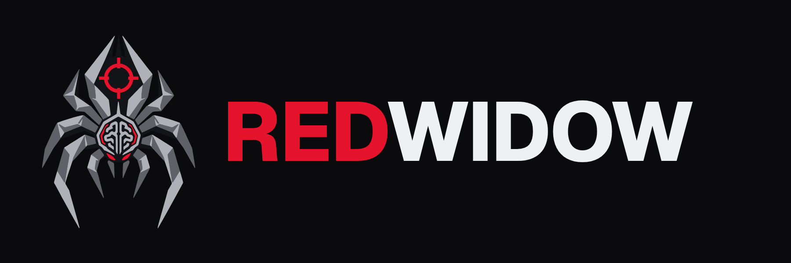
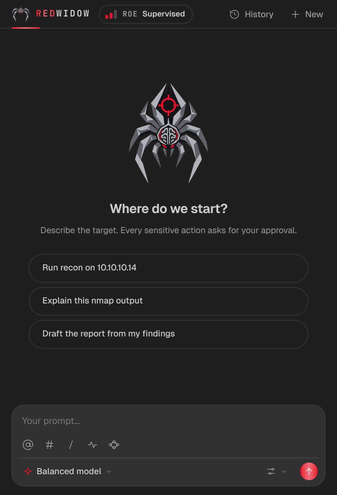
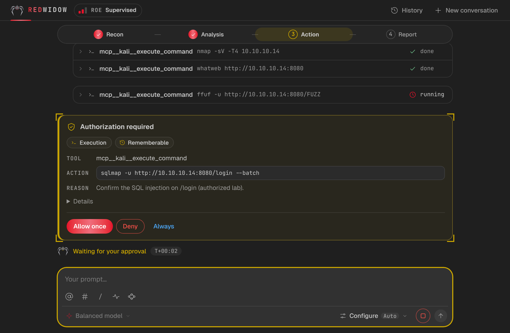
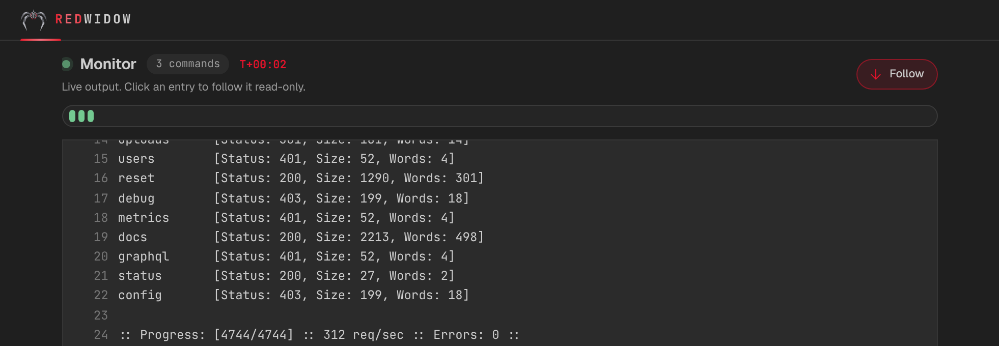
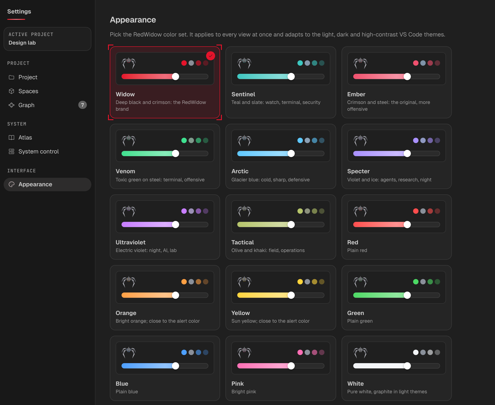

<div align="center">



# RedWidow

**Pentest in VS Code, with AI on call.**

Your Exegol and Kali containers, their terminals, a Monitor, a kill chain, a
coverage matrix and reports in one workspace. An AI agent helps when you call
it, under your approval.


[Français](README.fr.md) · [Download](https://github.com/tomtimlt/RedWidow/releases) · [Issues](https://github.com/tomtimlt/RedWidow/issues)



</div>

---

> [!WARNING]
> **For authorized testing only: CTFs, labs and scoped engagements.**
> Only test systems you own or have written permission to test. You are
> responsible for what the agent does on your behalf.

> [!NOTE]
> **Public beta 1.0.** RedWidow is usable day to day but young. It promises no
> result: how far a mission goes depends on the model you pick and on the
> target. See [known limits](#known-limits).

## What it is

A pentest means dozens of terminals, scans and notes scattered everywhere.
RedWidow brings them together inside VS Code:

- **Exegol and Kali containers**, prepared and managed from a cockpit, with terminals that open straight inside them.
- **An AI agent you call** to run tools in your container, read the results and suggest next leads. Every sensitive action goes through an approval card.
- **A Monitor** that follows every command and web request the agent makes, live.
- **A kill chain**: hosts, credentials, sites, steps and loot linked together, each step tagged with its MITRE ATT&CK technique.
- **A coverage matrix**: what was tested, negative, blocked or confirmed, in colour, with a banner when a finding is confirmed.
- **A full, exportable log** of the mission, to account for it or to measure the agent.

The AI is a helper you call, not the pilot. Learning mode only reads and explains.

## One profile per kind of mission

| Profile | For | Document required |
|---|---|---|
| **Pentest** (default) | Quick, ad-hoc mission, every tool after approval | None |
| **HTB / CTF** | Enumeration, exploitation, flags | None |
| **Bug bounty** | Respect a program's rules, minimal proof | Program sheet |
| **Red Team** | Campaign plan, ATT&CK, deconfliction | Engagement sheet |
| **Mentor** | Teaching: the agent explains, it does not act | None |

No profile asks for another profile's documents: a pentest needs no bug bounty
sheet, a CTF needs no contract.

## Features

### Drive the agent, stay in control

Write your prompt in the chat. The agent proposes, you approve: a card shows
the tool, the command and the reason, with *Allow once*, *Deny* or *Always*.

<div align="center">

</div>

- `@` to mention a container, `#` to mention an open terminal, `/` for commands.
- Several conversations in parallel, with a history shared by project.
- A choice of **provider** and **model** (OpenCode, Claude, OpenAI) for the next message.
- **Relentless** supervision level: the agent is nudged to keep going while it still has leads it can pursue alone, and stops when only you can unblock it.
- A **Stop** button in the prompt box while a run is active.
- **Bypass** with a duration you choose (1 minute to 48 hours) or unlimited, for when you want the agent to work without asking. It switches off when the engine stops.

### Test accounts

A **Test accounts** page stores your credentials or a session cookie in the VS
Code secret store. The agent uses them to test authenticated areas, keeping the
session between requests. Values are masked in logs and exports.

### Program sheet filled by AI

For a bug bounty, paste the program URL and click **Fill with AI**: a dedicated
conversation reads the page and drafts the scope, exclusions, pace and
User-Agent, citing its sources. You review and validate it. Nothing applies
before you do.

### Follow the execution and keep a trace

<div align="center">

</div>

- The **Monitor** lists every agent action, shell and web, with filters.
- **Audit** keeps actions, decisions and project captures. A ZIP export holds the mission thread, the logs and SHA-256 hashes.
- **Long outputs** are kept in full and can be read back by slice or by search.

### Follow your attack

<div align="center">

</div>

Every finding has a **state** (confirmed, hypothesis, failed), a **MITRE ATT&CK
technique** and cause-and-effect links to the others. **Replay** walks the
selected path node by node. Click a node for its full card.

### Make it yours

23 colour sets, light and dark.

<div align="center">

</div>

### Measure a run

The `trace` command reads a run's audit ZIP and tells you where it lost time:
number of calls, repetitions, searches, the share of requests derived from what
the agent had observed, and the likely class of blocker.

```bash
node packages/cli/dist/main.js trace my-audit.zip
```

## Install

Requirements: **VS Code 1.90+**, **Docker** running, an **Exegol** or Kali
container (RedWidow can prepare one), and an account with a model provider
(OpenCode offers free models).

1. Download the `.vsix` for your platform from the [latest release](https://github.com/tomtimlt/RedWidow/releases):

   | Platform | File |
   |---|---|
   | Windows (x64) | `redwidow-1.0.1-win32-x64.vsix` |
   | Linux (x64) | `redwidow-1.0.1-linux-x64.vsix` |
   | macOS, Apple Silicon | `redwidow-1.0.1-darwin-arm64.vsix` |
   | macOS, Intel | `redwidow-1.0.1-darwin-x64.vsix` |

2. In VS Code: *Extensions* → `···` menu → **Install from VSIX…**
3. Open **RedWidow** in the activity bar.

On macOS, Docker Desktop must be running. RedWidow looks for `docker` in your
`PATH`, in `~/.docker/bin`, in `/usr/local/bin` and in `/opt/homebrew/bin`.

## Quick start

1. **Settings → Providers**: set up a model provider.
2. **Settings → Project**: create a project (its folder is created for you).
3. **Cockpit → New container**: it links itself to the project.
4. In the chat, **Configure**: pick provider, model and supervision level.
5. Write your prompt, for example “scan 10.10.11.42 and summarize the exposed services”.

## Known limits

- **Beta**: UI defects are possible, please report them.
- Not on the Marketplace yet: install from the `.vsix` file.
- Windows and Linux are tested. **macOS builds exist but have not been tested on real hardware yet**: please report what you find.
- **Learning mode** reads the course folder you fill yourself (Settings → Atlas → Open course folder). No course is bundled.
- Results depend on the model: a free model finds less than a frontier model.
- Automatic nudging at the Relentless level works with OpenCode.

## Licenses and third-party content

RedWidow is released under the **MIT** license ([LICENSE](LICENSE)).
Third-party content (OWASP, HackTricks, Attack Flow, OpenCode) and its
licenses are listed in [THIRD_PARTY_NOTICES.md](THIRD_PARTY_NOTICES.md).
Exegol, Kali Linux, HackTheBox, OWASP and MITRE ATT&CK are names of their
respective owners; RedWidow is not affiliated with any of them.
