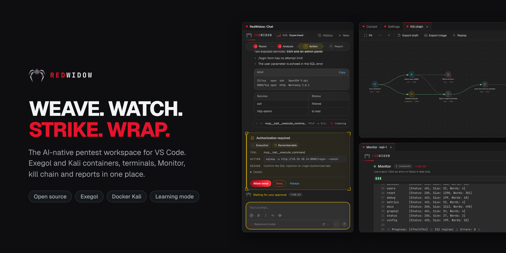
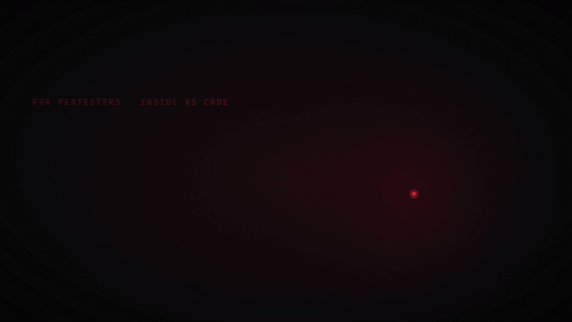
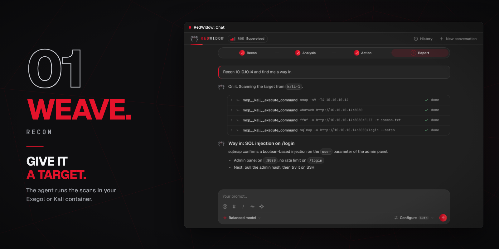
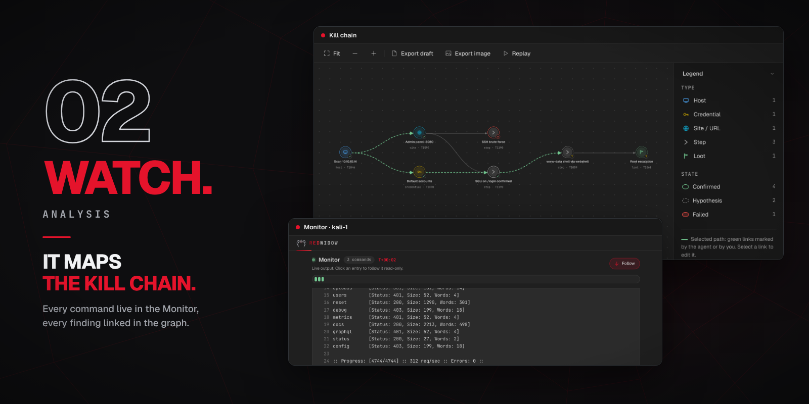
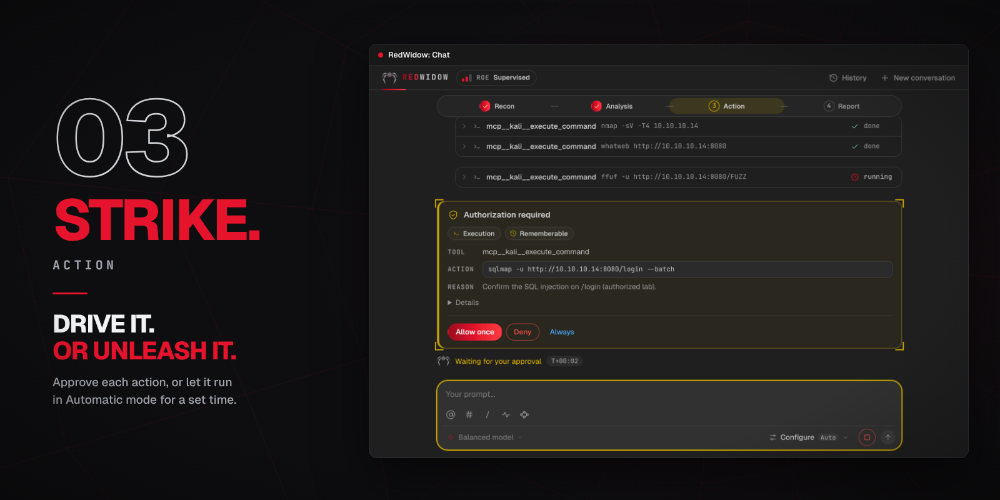
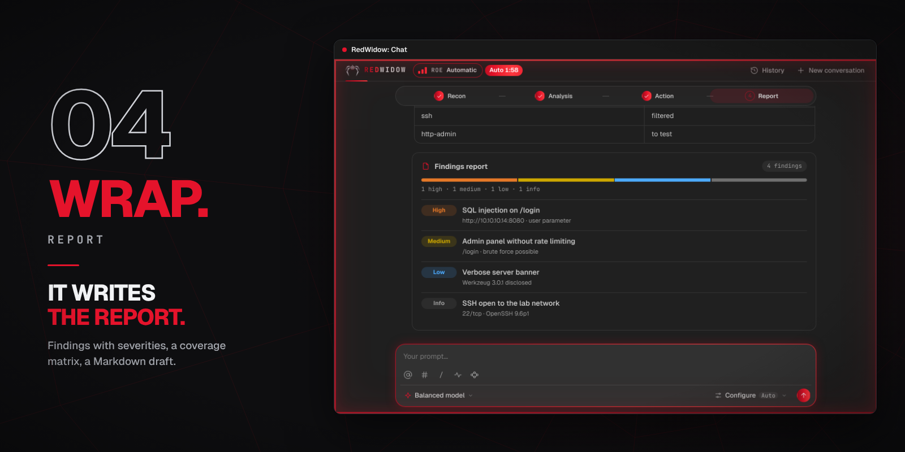
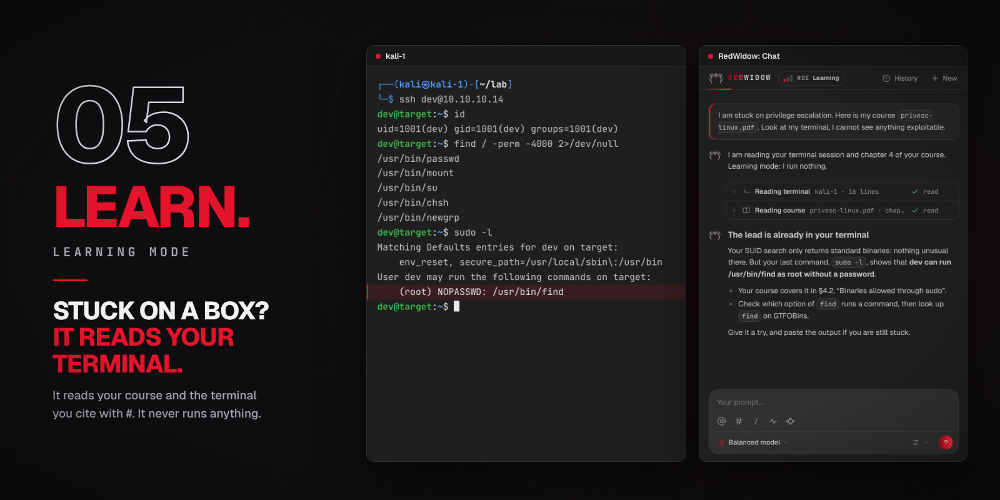
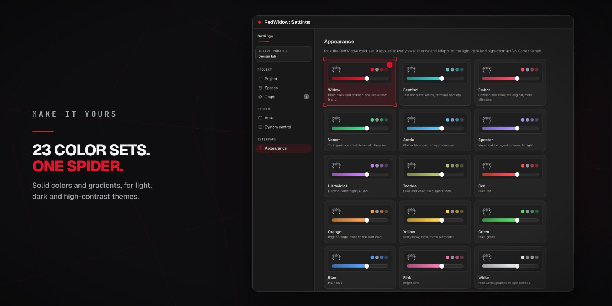

<div align="center">



<br>
<br>

Exegol and Kali containers, terminals, a live Monitor, a kill chain, a coverage
matrix and reports in one place,<br>with an AI agent that runs only what you approve.

<br>

[](https://github.com/tomtimlt/RedWidow/releases)
[](LICENSE)


**[Download](https://github.com/tomtimlt/RedWidow/releases)** ·
**[Quick start](#quick-start)** ·
**[Français](README.fr.md)** ·
**[Report an issue](https://github.com/tomtimlt/RedWidow/issues)**

</div>

<br>

<div align="center">

<br>
<sub><a href="docs/video/redwidow-promo.mp4">▶ Watch the 50-second film</a></sub>
</div>

<br>

> [!WARNING]
> **For authorized testing only: CTFs, labs and scoped engagements.**
> Only test systems you own or have written permission to test. You are
> responsible for what the agent does on your behalf.

## Weave. Watch. Strike. Wrap.

A pentest means dozens of terminals, scans and notes scattered everywhere.
RedWidow hunts the way a widow does, and keeps the whole mission in one
place inside VS Code.

| | Phase | What RedWidow does |
| :-- | :-- | :-- |
| **[01 Weave](#01-weave--recon)** | Recon | Prepares your Exegol and Kali containers and runs the scans in them. |
| **[02 Watch](#02-watch--analysis)** | Analysis | Shows every command live and links every finding in a kill chain. |
| **[03 Strike](#03-strike--action)** | Action | Asks before each sensitive action, or works on its own for a time you set. |
| **[04 Wrap](#04-wrap--report)** | Report | Tracks coverage, keeps an audit trail and drafts the report. |
| **[05 Learn](#05-learn--learning-mode)** | Learning mode | Explains where you stand from your course and your terminal. It never runs anything. |

The AI is a helper you call, not the pilot.

<br>

## 01 Weave · Recon



- **Exegol and Kali containers**, prepared and managed from the cockpit. Terminals open straight inside them, like any editor terminal.
- **Give it a target** in the chat. The agent runs the tools in your container, reads the results and suggests the next leads.
- `@` mentions a container, `#` an open terminal (the agent reads its output), `/` opens the commands.
- Several conversations in parallel, with a history shared by project.
- The **provider** and the **model** of your choice for the next message: OpenCode, Claude or OpenAI.

## 02 Watch · Analysis



- **The Monitor** follows every command and web request the agent makes, live, with filters.
- **The kill chain** links hosts, credentials, sites, steps and loot. Every finding has a state (confirmed, hypothesis, failed) and its **MITRE ATT&CK** technique. **Replay** walks the selected path node by node, and a click on a node opens its full card.
- **Long outputs** are kept in full and can be read back by slice or by search.

## 03 Strike · Action



- **Drive it.** The agent proposes, you approve: a card shows the tool, the command and the reason, with *Allow once*, *Deny* or *Always*.
- **Or unleash it.** **Bypass** lets the agent work without asking, for a time you choose (1 minute to 48 hours) or without limit. It switches off when the engine stops.
- The **Relentless** supervision level nudges the agent to keep going while it still has leads it can pursue alone, and to stop when only you can unblock it.
- A **Stop** button in the prompt box while a run is active.
- **Test accounts** keep your credentials or a session cookie in the VS Code secret store, so the agent can test authenticated areas. Values are masked in logs and exports.

## 04 Wrap · Report



- **A coverage matrix** shows what was tested, negative, blocked or confirmed, in color, with a banner when a finding is confirmed.
- **The audit** keeps actions, decisions and project captures. Its ZIP export holds the mission thread, the logs and SHA-256 hashes.
- **The report draft** exports as Markdown, ready to complete with your evidence and remediations.
- **Measure a run**: the `trace` command reads an audit ZIP and tells you where the agent lost time (calls, repetitions, searches, likely blocker).

```bash
node packages/cli/dist/main.js trace my-audit.zip
```

## 05 Learn · Learning mode



Stuck on an HTB box? Add your course, cite your terminal session with `#`, and
RedWidow explains where you stand based on what you actually typed. Learning
mode only reads courses and terminal context: it cites its sources, gives a
hint rather than the answer, and never runs or writes anything.

No course ships with RedWidow: add openly licensed material, one folder per source.

## One profile per mission

| Profile | For | Document required |
| :-- | :-- | :-- |
| **Pentest** (default) | Quick, ad-hoc mission, every tool after approval | None |
| **HTB / CTF** | Enumeration, exploitation, flags | None |
| **Bug bounty** | Respecting a program's rules, minimal proof | Program sheet |
| **Red Team** | Campaign plan, ATT&CK, deconfliction | Engagement sheet |
| **Mentor** | Teaching: the agent explains, it does not act | None |

No profile asks for another profile's documents. For a bug bounty, paste the
program URL and click **Fill with AI**: a dedicated conversation reads the page
and drafts the scope, exclusions, pace and User-Agent, citing its sources.
Nothing applies before you validate it.

## Make it yours



Each color set is tuned for light, dark and high-contrast themes and applies to
every view at once. Widow, deep black and crimson, is the default.

<br>

## Install

**Requirements:** VS Code 1.90+, Docker running, an Exegol or Kali container
(RedWidow can prepare one), and an account with a model provider (OpenCode
offers free models).

1. Download the `.vsix` for your platform from the [latest release](https://github.com/tomtimlt/RedWidow/releases):

   | Platform | File |
   |---|---|
   | Windows (x64) | `redwidow-1.0.4-win32-x64.vsix` |
   | Linux (x64) | `redwidow-1.0.4-linux-x64.vsix` |
   | macOS, Apple Silicon | `redwidow-1.0.4-darwin-arm64.vsix` |
   | macOS, Intel | `redwidow-1.0.4-darwin-x64.vsix` |

2. In VS Code: **Extensions** → `···` → **Install from VSIX…**
3. Open **RedWidow** in the activity bar.

On macOS, Docker Desktop must be running. RedWidow looks for `docker` in your
`PATH`, in `~/.docker/bin`, in `/usr/local/bin` and in `/opt/homebrew/bin`.

## Quick start

1. **Settings → Providers**: set up a model provider.
2. **Settings → Project**: create a project. Its folder is created for you.
3. **Cockpit → New container**: it links itself to the project.
4. In the chat, **Configure**: pick the provider, the model and the supervision level.
5. Give it a target, for example *“scan 10.10.11.42 and summarize the exposed services”*.

## Known limits

- **Public beta.** RedWidow is usable day to day but young: interface defects are possible, please [report them](https://github.com/tomtimlt/RedWidow/issues).
- Not on the Marketplace yet: install from the `.vsix` file.
- Windows and Linux are tested. **macOS builds exist but have not been tested on real hardware yet**: please report what you find.
- Results depend on the model: a free model finds less than a frontier model, and RedWidow promises no result.
- Automatic nudging at the Relentless level works with OpenCode.

## License and credits

RedWidow is open source under the **[MIT](LICENSE)** license. Third-party
content (OWASP, HackTricks, Attack Flow, OpenCode) and its licenses are listed
in [THIRD_PARTY_NOTICES.md](THIRD_PARTY_NOTICES.md). Exegol, Kali Linux,
HackTheBox, OWASP and MITRE ATT&CK are names of their respective owners;
RedWidow is not affiliated with any of them.

<div align="center">
<br>
<sub>Built for the people who break things on purpose, with permission.</sub>
</div>
