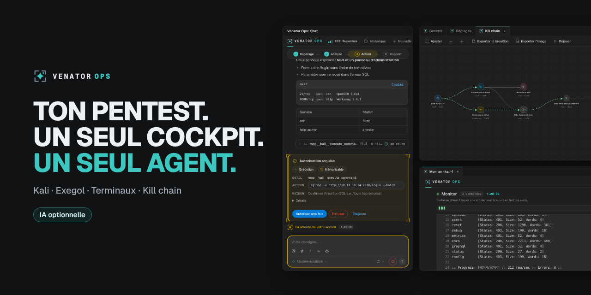
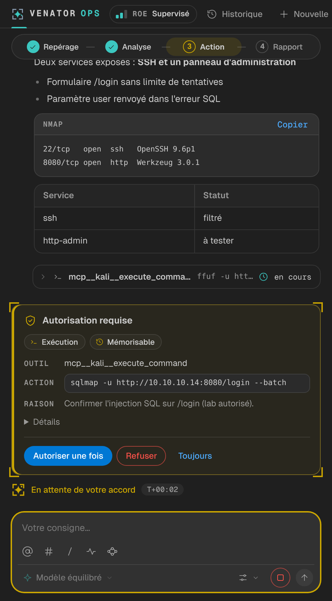
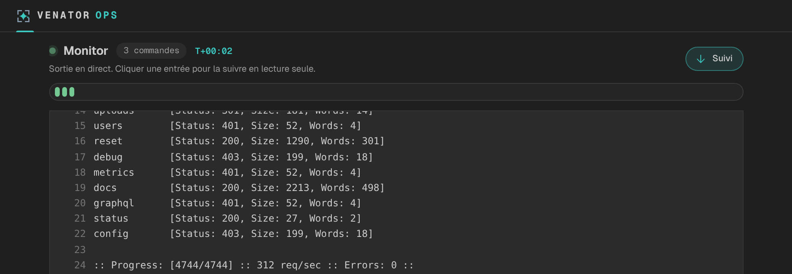
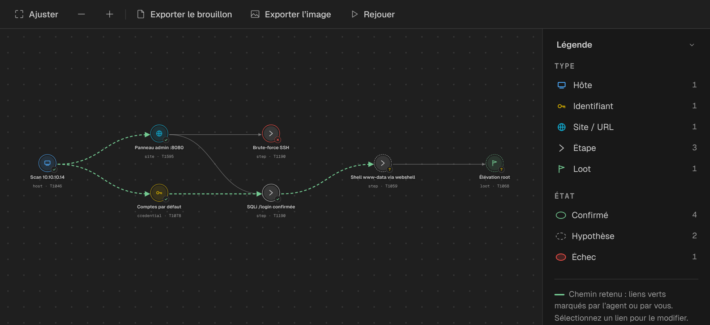
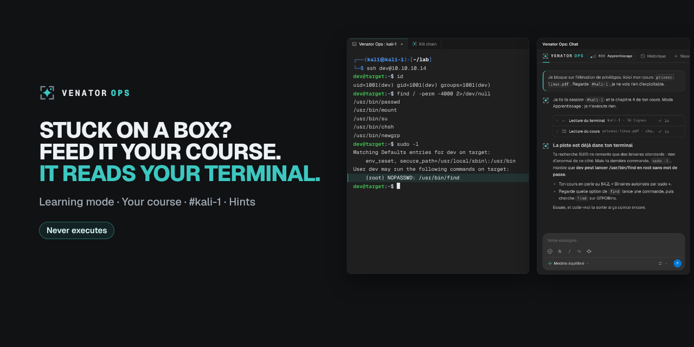

# Venator Ops

**Pentest dans VS Code, avec l’IA d’astreinte.**

Tes conteneurs Docker Kali et Exegol, leurs terminaux, un Monitor, une kill chain
et des rapports au même endroit. Un agent IA t’aide quand tu l’appelles, et
n’exécute que ce que tu autorises.

 

---

> **À utiliser uniquement dans un cadre autorisé** : CTF, labs de certification,
> engagement avec périmètre et accord écrit.

## Pourquoi Venator Ops

Un pentest, c’est des dizaines de terminaux, de scans, de notes et de captures
éparpillés. Venator Ops les rassemble dans VS Code :

- **Tes conteneurs Docker Kali et Exegol** se préparent et se pilotent depuis le cockpit.
- **Tes terminaux** s’ouvrent directement dans le conteneur, comme n’importe quel terminal de l’éditeur.
- **Le Monitor** suit chaque commande lancée : son état et sa sortie en direct.
- **La kill chain** dessine ce que tu trouves : hôtes, identifiants, sites, étapes et butin, reliés entre eux, avec la technique MITRE ATT&CK de chaque étape.
- **Un agent IA** est là quand tu en as besoin : il lance les outils de ton conteneur, explique et propose. Il ne fait rien de sensible sans ton accord.

Tu peux travailler à la main dans tes terminaux et n’appeler l’agent qu’au moment où tu bloques. L’IA est un renfort, pas un passage obligé.

## Ce que tu peux faire

### Demander à l’agent, et garder la main

Tu écris ta consigne dans le chat. Quand l’agent veut lancer une commande, une
carte te dit **quel outil**, **avec quoi** et **pourquoi**. Tu choisis :
*Autoriser une fois*, *Refuser* ou *Toujours* (pour la conversation en cours).

Dans le chat, tu disposes aussi de :

- `@` pour citer un conteneur, `#` pour citer un terminal ouvert (l’agent lit sa sortie), `/` pour les commandes ;
- jusqu’à **quatre conversations** en parallèle, et un **historique** filtré par projet ;
- le choix du **modèle** et de l’**effort de raisonnement** pour le message suivant ;
- la recherche sur le web (documentation, README, releases GitHub), avec les sources et la date de consultation.

### Voir ce qui se passe : le Monitor

Chaque commande apparaît avec son état et sa sortie en direct. Une frise te
permet de sauter à n’importe quelle commande ; la flèche vers le bas active ou
suspend le suivi automatique.

### Suivre ton attaque : la kill chain

Hôtes, identifiants, sites, étapes, butin : chaque trouvaille a un **état**
(confirmé, hypothèse, échoué), une **technique MITRE ATT&CK** et des liens de
cause à effet avec les autres. Le graphe se parcourt à la souris et au clavier ;
**Rejouer** déroule le chemin retenu nœud par nœud, sans rien exécuter.

### Apprendre : le mode Apprentissage

Tu bloques sur une box HTB ? Donne-lui ton cours, cite ta session de terminal
avec `#`, et il t’explique où tu en es à partir de ce que tu as vraiment tapé.
**Il lit et explique, il n’exécute rien.** Il cite ses sources.

### Garder une trace et rédiger

Chaque mission est consignée dans un journal que tu peux relire. L’**aperçu du
rapport** présente les trouvailles du projet actif, sans identifiants ni butin,
et l’export produit un **brouillon Markdown** à compléter avec tes preuves et
tes remédiations. Les gravités restent « À évaluer » : c’est toi qui les
décides. Aucun outil de rapport externe n’est nécessaire.

## Installation

Prérequis : **VS Code 1.90 ou plus** et **Docker** pour les conteneurs.

1. Télécharge le fichier `.vsix` de ta plateforme (**Windows** ou **Linux**) dans les [releases](https://github.com/tomtimlt/warband/releases).
2. Installe-le : `code --install-extension <fichier>.vsix`, ou dans VS Code **Extensions → … → Installer à partir d’un VSIX**.
3. Recharge la fenêtre VS Code.

Venator Ops n’est pas encore sur le Marketplace : l’installation se fait à la main.

## Premier lancement

1. Ouvre un **dossier de confiance** dans VS Code.
2. Si tu veux utiliser l’agent, ouvre **Configurer** dans le chat, choisis ton fournisseur (voir plus bas) et ajoute ton accès. Il est stocké dans le stockage sécurisé de VS Code.
3. Ouvre **Réglages → Projet** : active un projet ou crée-le (un nom et un dossier).
4. Dans le **cockpit**, associe les conteneurs Kali ou Exegol du projet, ou crée-les.
5. Ouvre le chat (icône Venator Ops de la barre d’activité) et écris ta consigne.

| Raccourci | Action |
| --- | --- |
| `Alt+J Alt+J` | Lanceur |
| `Alt+J C` | Chat latéral |
| `Alt+J N` | Nouveau chat dans l’éditeur |
| `Alt+J K` | Cockpit |
| `Alt+J M` | Monitor |
| `Alt+J S` | Réglages |

## Tu gardes la main

- **Chaque action sensible passe par une carte d’autorisation**, décidée par du code et jamais laissée au bon vouloir du modèle.
- Ce qui est refusé par la politique, un chemin sensible ou hors de ton espace de travail, un accès à l’hôte ou une commande dangereuse ne peut **jamais être mémorisé** avec « Toujours ».
- « Toujours » demande une **confirmation native de VS Code**.
- Dans le chat, l’agent **ne crée, n’arrête et ne supprime aucun conteneur**. Il ne travaille que dans les conteneurs autorisés du projet.
- Les mots de passe, jetons et clés sont **masqués** avant d’être enregistrés dans un journal.
- **Bypass** : un mode explicite qui approuve tout pendant une durée limitée (2 h par défaut, 4 h au plus). Il est signalé en magenta avec un compte à rebours et n’existe jamais en mode Apprentissage. À n’activer que sciemment, sous ta responsabilité.

## Questions fréquentes

**Faut-il un compte pour l’agent ?**
Oui, auprès du fournisseur de ton choix. **Claude** (jeton d’abonnement ou clé API), **OpenAI** (abonnement ChatGPT ou clé API) ou **OpenCode**, qui ouvre aussi la porte à Gemini, à des modèles locaux avec Ollama et à des points d’accès compatibles. Tu peux changer de fournisseur en gardant la même conversation.

**Puis-je l’utiliser sans IA ?**
Oui pour tout ce qui entoure l’agent : le cockpit, les conteneurs, les terminaux dans le conteneur et le Monitor. L’agent n’est lancé que lorsque tu envoies une consigne.

**Sur quels systèmes ça fonctionne ?**
Windows (natif, sans WSL) et Linux.

**Où sont mes données ?**
Les journaux de conversation sont stockés par VS Code sur ta machine, hors de ton dépôt. L’historique conserve environ les 100 dernières conversations.

**Je suis en CTF ou en lab : y a-t-il des profils ?**
Oui, des profils de méthode (mentor, bug bounty, out of the box, red team, HTB) guident l’agent.

**L’interface s’adapte à mon thème ?**
Oui : thèmes clair, sombre et contraste élevé, mouvement réduit respecté, cinq jeux de couleurs au choix dans **Réglages → Apparence**.

## Statut

Projet personnel en développement actif. La version publiée s’installe à la main (`.vsix`) et n’a pas encore été éprouvée dans toutes les configurations de VS Code (fenêtres distantes, version web). Les limites connues sont détaillées dans le [guide de l’extension](docs/extension-vscode.md#limites-connues).

## Aller plus loin

| | |
| --- | --- |
| [Guide de l’extension](docs/extension-vscode.md) | Installation, usage et limites |
| [État du projet](docs/etat-du-projet.md) | Ce qui existe et ce qui reste à faire |
| [Ligne de commande](docs/cli.md) | Pilotage et politique d’approbation hors de VS Code |
| [Développer](docs/adr/README.md) | Pour les développeurs : décisions d’architecture et organisation du code |

## Licence

[MIT](LICENSE).
