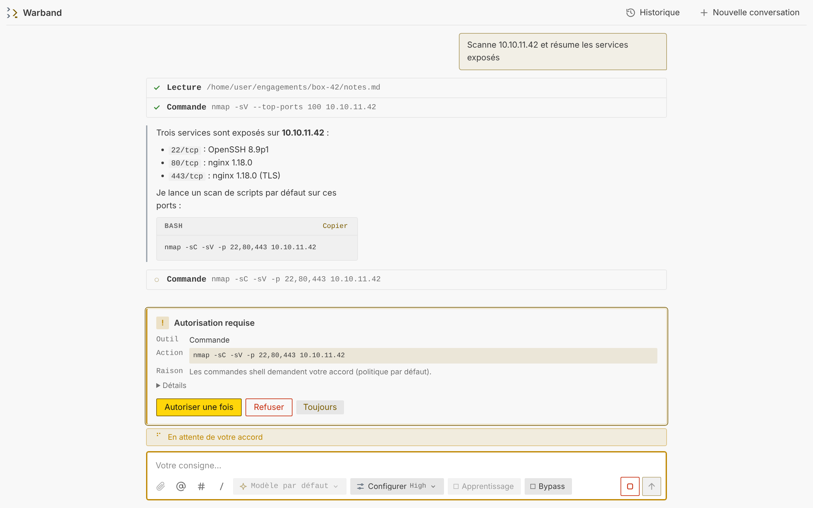
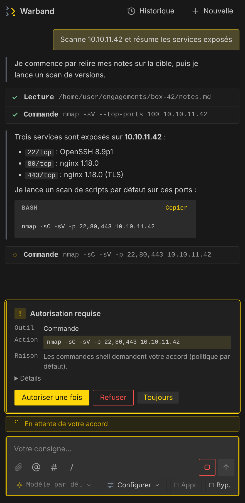
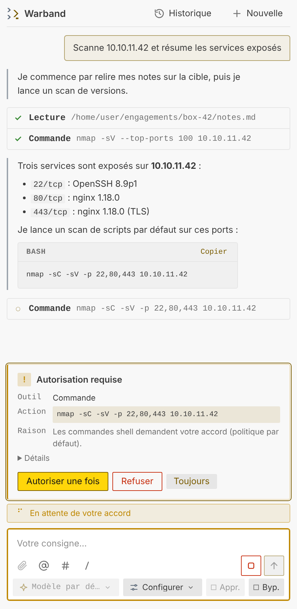
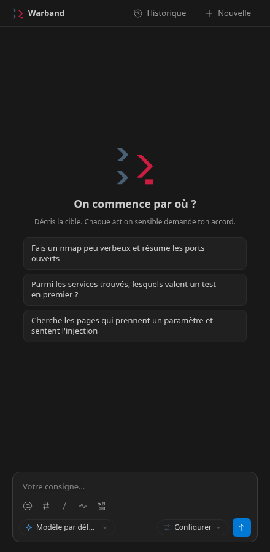
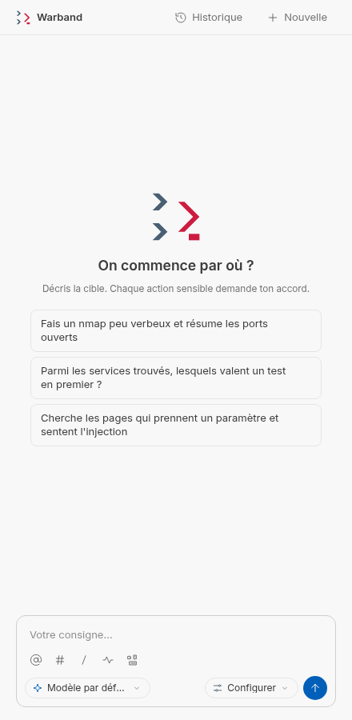
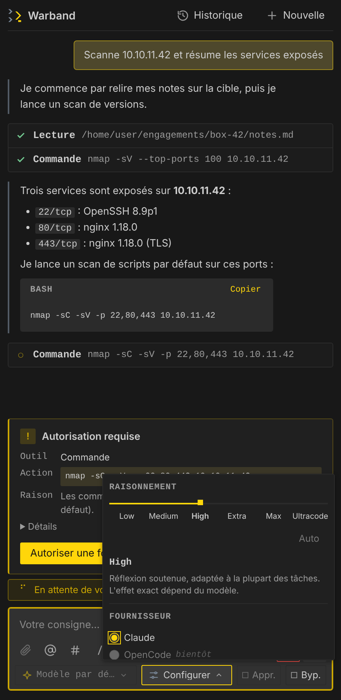
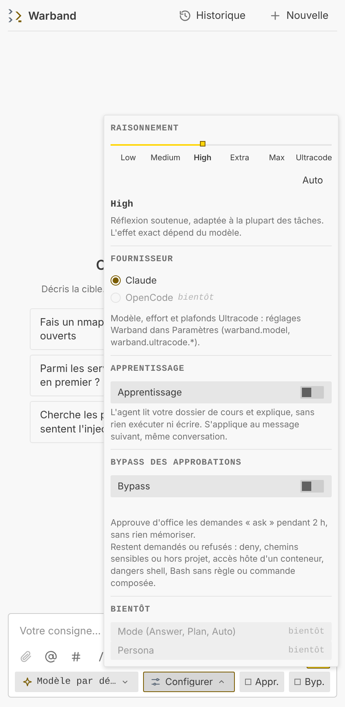
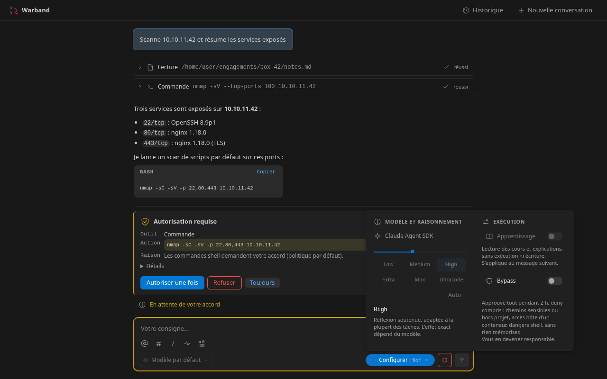

<div align="center">

<picture>
  <source media="(prefers-color-scheme: dark)" srcset="packages/vscode/media/logo.svg">
  
</picture>

# Warband

**Un chat d'agent IA pour VS Code où chaque action sensible demande ton accord.**

[](https://github.com/tomtimlt/warband/actions/workflows/ci.yml)
[](LICENSE)


<br>

<picture>
  <source media="(prefers-color-scheme: dark)" srcset="docs/img/paysage-chat-sombre.png">
  
</picture>

</div>

---

## Pourquoi Warband

Les agents IA savent lancer des commandes, lire et écrire des fichiers, piloter des conteneurs. Le plus souvent, on leur fait confiance en bloc ou on valide au hasard. Warband part du principe inverse : **une seule autorité décide de chaque appel d'outil**, et elle est écrite en code, pas en consigne au modèle.

Chaque appel passe par une gate d'approbation. Elle applique une politique (`allow`, `ask`, `deny`), affiche une carte claire dans le chat, et journalise tout. Un refus de politique, un chemin sensible ou un danger shell ne se contournent jamais, même avec un « Toujours ».

## Fonctionnalités

**Un chat dans VS Code**
- Chat latéral ou dans l'éditeur, jusqu'à **quatre conversations** en parallèle.
- Sélecteur de **modèle** (liste fournie par le SDK au runtime) et curseur d'**effort** à six crans.
- **Historique** des conversations, relu depuis les journaux, en lecture seule.
- Mentions : `@` pour citer un conteneur, `#` pour citer un terminal ouvert, `/` pour les commandes.
- Interface responsive de 280 px à plus de 900 px, thèmes sombre, clair et contraste élevé, mouvement réduit respecté.

**Une approbation qui a du sens**
- Une carte par demande : outil, entrée neutralisée, raison de la politique. *Autoriser une fois*, *Refuser* ou *Toujours*, ce dernier sous confirmation native de VS Code et seulement quand c'est sûr.
- **Bypass** borné : approuve d'office les demandes « ask » pendant 2 h, sans rien mémoriser, et ne lève jamais un `deny`, un chemin sensible ou un danger shell.
- **Mode Apprentissage** : l'agent lit des cours en lecture seule, explique et cite ses sources, et n'agit jamais.

**Un moteur traçable**
- Journal d'événements en JSONL, **graphe causal** exportable en HTML autonome.
- Secrets masqués avant tout enregistrement ; processus enfants lancés avec une liste blanche de variables.
- Outils **Docker structurés** (`ps`, `logs`, `inspect`, `run`…) et **bac à sable** optionnel : conteneur dédié, utilisateur non root, sans volume, réseau coupé par défaut.
- Deux moteurs d'agent : le **Claude Agent SDK** et **OpenCode** (OpenAI, Gemini, Ollama, tout endpoint compatible…), derrière la même gate.

**Windows d'abord**
- Support natif, sans WSL. Les processus sont arrêtés proprement, arbre entier compris.

## Aperçu

<div align="center">

| Sombre | Clair |
| :---: | :---: |
|  |  |
| *Une carte par demande : outil, action, raison* | *Le même écran en thème clair* |
|  |  |
| *Accueil* | *Accueil en thème clair* |
|  |  |
| *Configurer : effort, fournisseur, Apprentissage, Bypass* | *Configurer en thème clair* |



</div>

## Démarrage rapide

Prérequis : Node 22 ou plus, [pnpm](https://pnpm.io), VS Code 1.90 ou plus. Docker est utile pour les outils de conteneur et le bac à sable.

### L'extension VS Code

```sh
pnpm install --frozen-lockfile
pnpm build
pnpm --filter @warband/vscode package        # cible win32-x64 par défaut
code --install-extension packages/vscode/warband-0.3.0-win32-x64.vsix
```

Raccourci : `pnpm maj` enchaîne mise à jour, build, empaquetage et installation.

Puis, dans VS Code, ouvre un dossier de confiance et :

1. **Warband : définir le jeton** (palette de commandes) : jeton d'abonnement (`claude setup-token`) ou clé API, stocké dans le stockage sécurisé de VS Code.
2. **Warband : ouvrir un chat** ou clique sur l'icône Warband de la barre d'activité.
3. Écris ta consigne. Chaque action sensible t'est demandée.

| Raccourci | Action |
| --- | --- |
| `Alt+J Alt+J` | Lanceur Warband |
| `Alt+J C` | Chat latéral |
| `Alt+J N` | Nouveau chat dans l'éditeur |
| `Alt+J K` | Cockpit |
| `Alt+J M` | Monitor |
| `Alt+J S` | Réglages |

### La ligne de commande

```sh
node packages/cli/dist/main.js run "liste les conteneurs arrêtés"
node packages/cli/dist/main.js policy check "docker ps -a | grep web"   # code 0 allow, 2 ask, 3 deny
node packages/cli/dist/main.js graph .warband/runs/<run>.jsonl -o run.html
node packages/cli/dist/main.js agents                                   # moteurs disponibles
```

Le guide complet de la CLI est dans [docs/cli.md](docs/cli.md).

## Sécurité

Ces règles ne s'affaiblissent pas :

- La **gate d'approbation est l'unique autorité**. Le hook `PreToolUse` du SDK décide ; le reste n'est qu'un filet qui refuse par défaut.
- Un `deny` de politique, un chemin sensible ou hors de l'espace de travail, un conteneur donnant accès à l'hôte et les dangers shell ne sont **jamais** contournables ni mémorisables.
- Les options du SDK qui touchent à la sécurité (mode de permission, outils, hooks, environnement…) sont **verrouillées** : un appelant ne peut pas les surcharger.
- Les secrets sont masqués avant d'atteindre un journal ; l'adresse e-mail du compte n'est jamais journalisée.
- **Bash est désactivé par défaut.**
- La politique d'un dépôt n'est appliquée qu'après **approbation de son empreinte**.
- L'extension vérifie l'empreinte SHA-256 du binaire embarqué avant de le lancer, et ses pages web ont une CSP stricte sans script en ligne.

Le détail est dans [docs/cli.md](docs/cli.md) et dans les [décisions d'architecture](docs/adr/README.md).

## Architecture

```
packages/
  core/            moteur : événements, journal, graphe, approbation (politique, gate, file), AgentRunner
  messages/        libellés (français complet, anglais minimal) pour les codes du moteur
  agent-sdk/       adaptateur du Claude Agent SDK, outils Docker, bac à sable
  agent-opencode/  adaptateur OpenCode
  cli/             interface en ligne de commande
  export-html/     rendu HTML/SVG autonome du graphe
  vscode/          extension VS Code (chat, cockpit, monitor, réglages)
```

Le cœur n'a aucune dépendance à un SDK d'agent et ne contient aucun texte d'affichage : il émet des événements typés et des codes, que les interfaces traduisent. Les interfaces dépendent du cœur, jamais l'inverse.

## Documentation

| Document | Contenu |
| --- | --- |
| [docs/cli.md](docs/cli.md) | Moteur, approbation, authentification, OpenCode, Docker, bac à sable, CLI |
| [docs/extension-vscode.md](docs/extension-vscode.md) | Installation, usage et limites de l'extension |
| [docs/design-chat-ui.md](docs/design-chat-ui.md) | Charte visuelle : couleurs, formes, mouvement, logo |
| [docs/adr/](docs/adr/README.md) | Décisions d'architecture |
| [docs/cours.md](docs/cours.md) | Sources du mode Apprentissage |
| [docs/idees.md](docs/idees.md) | Idées en réserve |

## Développement

```sh
pnpm check   # biome + tsc (sources et tests) + vitest
pnpm build
```

Le CI exécute `pnpm check` et `pnpm build` sur Linux (Node 22 et 24) et sous Windows (Node 22).

## Statut

Projet personnel en développement actif. L'extension se distribue sous forme de `.vsix` à installer à la main (cible construite et testée : `win32-x64`), pas encore sur le Marketplace. Elle n'a pas encore été éprouvée dans toutes les configurations de VS Code (remote, web) : voir les [limites connues](docs/extension-vscode.md#limites-connues).

## Licence

[MIT](LICENSE).
