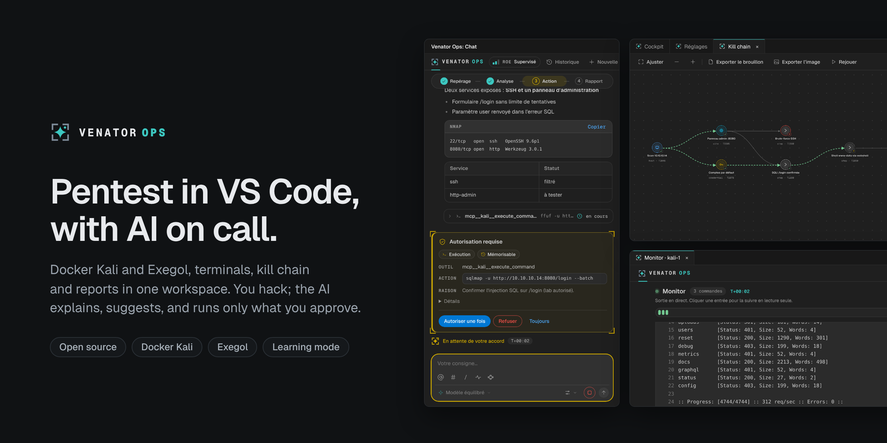

# Venator Ops — atelier de design VS Code

*Pentest in VS Code, with AI on call* : un espace de travail avec conteneurs
Docker Kali et Exegol, terminaux, Monitor, kill chain et rapports au même endroit. On peut tout
faire à la main ; l’agent IA est une option, pas un passage obligé.

Prototype autonome pour travailler la présentation : conversation, Monitor,
graphe interactif et réglages. Les projets, modèles, messages et activités sont
fictifs. Les interactions modifient uniquement l’état de démonstration en mémoire.

## Lancer dans VS Code

1. Ouvrir ce dossier dans VS Code.
2. Appuyer sur **F5**, configuration **Venator Ops · Démonstration**.
3. Dans la fenêtre de développement, ouvrir **Venator Ops** dans la barre d’activité
   ou utiliser la palette : **Venator Ops : ouvrir le chat / le graphe / le Monitor / les réglages**.
4. Utiliser **Venator Ops : choisir un scénario** pour passer entre accueil,
   conversation, activité, validation, indisponibilité et historique long.
5. **Réglages › Apparence** (ou **Venator Ops : choisir une palette**, ou le
   réglage `warbandDesign.palette`) change le jeu de couleurs : Sentinelle,
   Braise, Spectre, Éditeur ou Multicolore.

Aucune installation de dépendance n’est nécessaire. La démonstration ne demande
aucune clé et ne contacte aucun fournisseur. Les activités affichées sont des
textes d’exemple : aucun terminal ni processus n’est lancé. Les boutons d’export
présentent un message de simulation et ne créent aucun fichier.

## Aperçu dans le navigateur

Avec Node 22 ou plus récent :

```sh
npm run preview
```

Ouvrir `http://127.0.0.1:4173`. La barre d’aperçu propose la vue, le scénario,
le thème et la palette. Le rendu natif de référence reste celui de la fenêtre VS Code lancée
avec F5. `PORT=4174 npm run preview` permet de choisir un autre port.

## Modifier et vérifier

- `media/chat.css` : couleurs, espacements, typographie, composants et graphe.
- `media/chat.js` : interactions et rendu de la conversation et du Monitor.
- `media/studio.js` : disposition du graphe, sélection, zoom, filtres et réglages.
- `media/icons.js` : pictogrammes SVG locaux, source unique pour toutes les vues.
- `src/views.mjs` : structure HTML des webviews et CSP.
- `src/demo.mjs` : fixtures et simulation des messages d’interface.
- `extension.cjs` : ouverture des vues et pont de démonstration VS Code.

```sh
npm run check
```

Le prototype possède un manifeste distinct (`warband-ui-design`, version 0.0.1).
Ses changements sont destinés à une revue graphique avant réintégration dans
l’application. Les instructions de design sont dans [DESIGN.md](DESIGN.md).

Licence MIT ; les polices Geist et Geist Mono (SIL Open Font License 1.1) sont
livrées localement avec leur licence dans `media/fonts/OFL-Geist.txt`.
Le pictogramme du raisonnement est sous licence CC Attribution ; ses crédits et
modifications figurent dans `media/ATTRIBUTIONS.md`.
